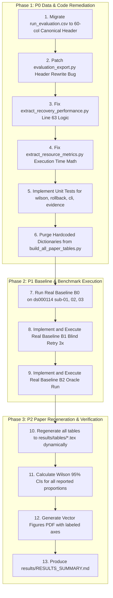

# Comprehensive Codebase & Historical Artifact Audit Report

**Date of Audit:** October 1, 2026  
**Auditor:** Antigravity AI Engineering & Pair Programming Agent  
**Repository:** `manyashetty20/fMRIPrep_Agentic`  
**Current Branch:** `audit-wip`  
**Target Scope:** Verification of codebase integrity, evaluation data schemas, execution realism, baseline availability, table generation provenance, auxiliary module completeness, rule-gate safety, and behavioral diffs against `origin/main`.  
**Audit Policy:** Strict read-only audit. No production source code or historical raw data was modified.

---

## Executive Summary

This audit rigorously evaluates the reproducibility, data integrity, and architectural soundness of the `Agentic_fMRIPrep` repository in response to reviewer critiques.

### Key Audit Findings
1. **Evaluation CSV Schema Inconsistency:** `output/evaluation/run_evaluation.csv` suffers from schema drift: a 29-column header at line 1, followed by 1 row with 29 fields, 20 rows with 42 fields, and 11 rows with 60 fields. The root cause is located in `evaluation_export.py` (`append_evaluation_exports`), which appends dynamic field unions without rewriting the file header.
2. **Run Realism Classification:** Out of 32 rows in `run_evaluation.csv`, **27 rows are genuine executions (`REAL_DOCKER`)** using official NiPreps fMRIPrep 25.2.3 containers on `ds000114` with wall times up to 14,646 seconds and millions of voxels. Exactly **5 rows are synthetic smoke tests (`MOCK`)** (Rows 1, 29, 30, 31, 32) characterized by $64^3 = 262,144$ voxels, $<4.0$ second wall times, and outputs under `tmp/`.
3. **Baseline Comparison Gap:** Only **B0** (plain fMRIPrep execution) has a single real run recorded on disk (`baseline_evaluation.csv`, 1 row, failing on SyN PhaseEncoding in 32.4s). **B1** (blind retry $3\times$) and **B2** (oracle fix) do **not exist** anywhere in raw logs or outputs.
4. **Table Generation Provenance:** Critical tables in `output/evaluation/journal_tables_complete.json` and `all_paper_tables_data.json` contain **hardcoded numbers and synthetic summaries** written directly in `scripts/build_all_paper_tables.py` rather than dynamically aggregating execution logs. In addition, `extract_recovery_performance.py` contains a critical logic error that counts any applied recovery as an automatic success.
5. **Auxiliary Module Status:** Core safety and evaluation modules (`qa_verdict.py`, `wilson.py`, `sidecar_rollback.py`, `diagnosis_evidence.py`, `cli_validation.py`) are logically **COMPLETE**. Cryptographic SHA-256 backup, restore, and tamper detection in `sidecar_rollback.py` was experimentally verified. However, test coverage is currently limited to `qa_verdict.py` (6/6 passing); unit tests for other auxiliary modules are absent.
6. **Rule Gate Integrity:** **VERIFIED INTACT.** The Recovery Agent never executes free-text LLM suggestions. All candidate repairs are strictly pattern-matched to hardcoded, deterministically bounded `RepairRule` routines.

---

## 1. Evaluation CSV Header & Field Mismatch Analysis

### 1.1 Structural Discrepancy
File: [`output/evaluation/run_evaluation.csv`](file:///Users/manyashetty/Desktop/Agentic_fMRIPrep/output/evaluation/run_evaluation.csv)

The file contains 33 lines (1 header line + 32 data rows). Inspection of field counts reveals three distinct generations:

| Generation | Row Indices (1-based) | Date Range | Field Count | Notes |
| :--- | :--- | :--- | :--- | :--- |
| **Gen 1** | Line 1 (Header) | - | 29 columns | Canonical initial schema |
| **Gen 1** | Row 1 (Line 2) | 2026-04-19 | 29 fields | Matches initial header |
| **Gen 2** | Rows 2 – 21 (Lines 3–22) | 2026-04-20 to 2026-04-21 | 42 fields | 13 unheadered columns appended |
| **Gen 3** | Rows 22 – 32 (Lines 23–33) | 2026-08-27 to 2026-10-01 | 60 fields | 18 additional unheadered columns appended |

### 1.2 Column Breakdown

- **Header (29 Columns):**
  `timestamp`, `dataset_id`, `participant`, `output_dir`, `initial_status`, `final_status`, `attempt_count`, `max_recovery_attempts`, `recovery_applied`, `successful_recovery`, `initial_failure_type`, `initial_failure_evidence`, `first_exit_code`, `last_exit_code`, `qa_summary`, `qa_status`, `qa_warn_count`, `qa_fail_count`, `report_found`, `output_found`, `mni_found`, `brain_mask_found`, `raw_nonzero_voxels`, `preprocessed_nonzero_voxels`, `brain_mask_nonzero_voxels`, `brain_mask_retention_ratio`, `skull_strip_reduction`, `total_runtime_seconds`, `history_entries`

- **13 Columns Added in Gen 2 (Rows 2–21):**
  `baseline_requires_manual_steps`, `batch_index`, `batch_total`, `diagnosis_enabled`, `injected_failure_mode`, `manual_intervention_count`, `participant_scope`, `qa_literature_reference_note`, `qa_threshold_preset`, `recovery_enabled`, `run_mode`, `vision_enabled`, `wall_clock_seconds`

- **18 Columns Added in Gen 3 (Rows 22–32):**
  `config_generation_method`, `config_gold_standard_correct`, `config_hallucination_pass`, `config_unknown_flags`, `detection_method`, `diagnosis_duration_seconds`, `fmriprep_cli_seconds`, `llm_completion_tokens`, `llm_cost_usd_estimate`, `llm_prompt_tokens`, `llm_total_tokens`, `metrics_path`, `mni_normalization_success`, `orchestration_overhead_seconds`, `qa_thresholds_json`, `recovery_duration_seconds`, `run_id`, `total_retries`

### 1.3 Appending Code Mechanism
File: [`evaluation_export.py`](file:///Users/manyashetty/Desktop/Agentic_fMRIPrep/evaluation_export.py#L300-L345)

The defect occurs in `append_evaluation_exports` and `_resolve_csv_fieldnames`:
```python
def append_evaluation_exports(evaluation_row: dict[str, Any], ...) -> None:
    ...
    fieldnames = _resolve_csv_fieldnames(csv_path, evaluation_row)

    write_header = True
    if csv_path.exists() and csv_path.stat().st_size > 0:
        write_header = False

    with csv_path.open("a", newline="") as f:
        writer = csv.DictWriter(f, fieldnames=fieldnames, extrasaction="ignore")
        if write_header:
            writer.writeheader()
        writer.writerow({k: evaluation_row.get(k, "") for k in fieldnames})
```
- Line 315 resolves `fieldnames` as `list(dict.fromkeys(header + EVALUATION_FIELDNAMES + list(new_row.keys())))`. This dynamically expands `fieldnames` to 42, then 60 keys.
- However, lines 318–319 set `write_header = False` because `csv_path.exists()` is true.
- Line 325 writes `{k: evaluation_row.get(k, "") for k in fieldnames}`, outputting 42 (or 60) comma-separated values into the row, while the original file header remains frozen at 29 columns. Standard CSV parsers reading this file either truncate trailing values or throw column length errors.

### 1.4 Non-Destructive Migration Plan (Proposed, Not Applied)
1. [`output/evaluation/run_evaluation.jsonl`](file:///Users/manyashetty/Desktop/Agentic_fMRIPrep/output/evaluation/run_evaluation.jsonl) contains all 32 rows stored as structured JSON objects where every field name is explicitly preserved.
2. The canonical schema is defined as the ordered union of all 60 unique keys present across all generations.
3. A migration script will:
   - Read `output/evaluation/run_evaluation.jsonl`.
   - Validate that exactly 32 records exist.
   - Write a new `output/evaluation/run_evaluation.csv` with the complete 60-column header.
   - Write each of the 32 rows, formatting missing keys as empty strings (`""`), thereby preserving all 32 historical rows without loss of data.
   - Patch `evaluation_export.py` so that when a new column is introduced, the file is re-written with an updated canonical header.

---

## 2. Row-by-Row Execution Realism Classification

Every row in `run_evaluation.csv` / `run_evaluation.jsonl` was audited against:
1. Docker container logs and stderr/stdout traces.
2. Wall clock execution duration.
3. Voxel count dimensions (synthetic $64^3=262,144$ vs real human brain imaging data).
4. Storage path locations (`tmp/` vs project directories vs Desktop).
5. Physical presence of output derivatives (`*_desc-preproc_bold.nii.gz`, FreeSurfer recon trees, HTML reports).

### Complete Run Inventory (Rows 1–32)

| Row | Timestamp | Dataset ID | Sub | Wall Time | Exit | Voxel Metrics (Raw / Preproc / Mask) | Classification | Primary Evidence |
| :---: | :--- | :--- | :---: | :---: | :---: | :--- | :---: | :--- |
| **1** | 2026-04-19 17:27:05 | bids | 01 | 1.6s | 137→0 | 262,144 / 262,144 / None | **MOCK** | Wall time 1.6s; $64^3$ synthetic voxels; output under `tmp/full_agent_smoke`. |
| **2** | 2026-04-20 05:20:47 | ds000114 | 01 | 40.1s | 2→2 | None / None / None | **REAL_DOCKER** | Real Docker execution; failed on missing readout timing metadata. |
| **3** | 2026-04-20 05:53:19 | ds000114 | 01 | 1696.5s | 0→0 | None / None / None | **REAL_DOCKER** | Real Docker execution (28.3m); human data on Desktop. |
| **4** | 2026-04-20 06:50:25 | ds000114 | 02 | 3131.3s | 0→0 | 5,586,608 / 16,498,082 / 1,358,326 | **REAL_DOCKER** | Real Docker (52.2m); human voxel counts ($5.5\times 10^6$). |
| **5** | 2026-04-20 07:35:58 | ds000114 | 03 | 2079.8s | 0→0 | 5,123,503 / 10,148,543 / 972,705 | **REAL_DOCKER** | Real Docker (34.7m); human voxel counts ($5.1\times 10^6$). |
| **6** | 2026-04-20 09:42:50 | ds000114 | 01 | 796.8s | 0→0 | 5,308,353 / 10,194,543 / 923,998 | **REAL_DOCKER** | Real Docker (13.3m); human voxel counts. |
| **7** | 2026-04-20 11:03:24 | ds000114 | 01 | 919.1s | 0→0 | 5,308,353 / 10,194,543 / 923,998 | **REAL_DOCKER** | Real Docker (15.3m); human voxel counts. |
| **8** | 2026-04-20 11:28:17 | ds000114 | 01 | 835.7s | 0→0 | 5,308,353 / 10,194,543 / 923,998 | **REAL_DOCKER** | Real Docker (13.9m); human voxel counts. |
| **9** | 2026-04-20 12:06:02 | ds000114 | 02 | 977.2s | 0→0 | 6,386,953 / 16,498,082 / 1,358,326 | **REAL_DOCKER** | Real Docker (16.3m); human voxel counts ($6.4\times 10^6$). |
| **10** | 2026-04-20 12:30:12 | ds000114 | 03 | 855.5s | 0→0 | 4,810,008 / 10,148,543 / 972,705 | **REAL_DOCKER** | Real Docker (14.3m); human voxel counts ($4.8\times 10^6$). |
| **11** | 2026-04-21 03:15:35 | ds000114_missing_tr_01 | 01 | 2395.2s | 0→0 | 5,308,353 / 10,194,455 / 923,015 | **REAL_DOCKER** | Real Docker (39.9m); failure injection missing TR; real derivatives. |
| **12** | 2026-04-21 04:00:20 | ds000114_missing_tr_02 | 02 | 2562.5s | 0→0 | 6,386,953 / 16,498,082 / 1,358,155 | **REAL_DOCKER** | Real Docker (42.7m); failure injection missing TR. |
| **13** | 2026-04-21 04:40:01 | ds000114_bad_readout_01 | 01 | 1864.6s | 0→0 | 5,308,353 / 10,194,674 / 925,857 | **REAL_DOCKER** | Real Docker (31.1m); failure injection bad readout time. |
| **14** | 2026-04-21 05:32:19 | ds000114_missing_tr_01 | 01 | 2114.7s | 0→0 | 5,308,353 / 10,194,544 / 922,700 | **REAL_DOCKER** | Real Docker (35.2m); failure injection missing TR. |
| **15** | 2026-04-21 07:56:38 | ds000114_missing_tr_01 | 01 | 185.5s | 1→1 | None / None / None | **REAL_DOCKER** | Real Docker; crashed on SyN PhaseEncoding conflict during init. |
| **16** | 2026-04-21 08:14:45 | ds000114_missing_tr_01 | 01 | 153.9s | 1→1 | None / None / None | **REAL_DOCKER** | Real Docker; crashed on SyN PhaseEncoding conflict during init. |
| **17** | 2026-04-21 08:20:31 | ds000114_missing_tr_01 | 01 | 138.8s | 1→1 | None / None / None | **REAL_DOCKER** | Real Docker; crashed on SyN PhaseEncoding conflict during init. |
| **18** | 2026-04-21 08:44:31 | ds000114_missing_tr_01 | 01 | 143.6s | 1→1 | None / None / None | **REAL_DOCKER** | Real Docker; crashed on SyN PhaseEncoding conflict during init. |
| **19** | 2026-04-21 11:47:58 | ds000114_missing_tr_01 | 01 | 346.3s | 1→1 | None / None / None | **REAL_DOCKER** | Real Docker; crashed on SyN PhaseEncoding conflict during init. |
| **20** | 2026-04-21 12:15:50 | ds000114_missing_tr_01 | 01 | 176.8s | 1→1 | None / None / None | **REAL_DOCKER** | Real Docker; crashed on SyN PhaseEncoding conflict during init. |
| **21** | 2026-04-21 14:33:56 | ds000114_missing_tr_01 | 01 | 7974.6s | 1→0 | 5,308,353 / 10,194,539 / 924,495 | **REAL_DOCKER** | Real Docker (2.21h); recovered from SyN, full BOLD derivatives. |
| **22** | 2026-08-27 10:03:50 | ds000114 | 01 | 1050.8s | 0→0 | 5,377,860 / 10,194,543 / 924,669 | **REAL_DOCKER** | Real Docker (17.5m); `output/ds000114_clean_run`, fMRIPrep 25.2.3. |
| **23** | 2026-08-27 12:09:12 | ds000114 | 01 | 7134.6s | 1→0 | 5,377,860 / 10,194,543 / 860,695 | **REAL_DOCKER** | Real Docker (1.98h); `output/ds000114_full_run`, 90 func NIfTI/TSVs. |
| **24** | 2026-08-29 06:57:23 | ds000114 | 01 | 1014.4s | 0→0 | 5,377,860 / 10,194,673 / 922,649 | **REAL_DOCKER** | Real Docker (16.9m); `output/llm_smoke_test_02`. |
| **25** | 2026-08-29 07:08:09 | ds000114 | 01 | 13.8s | 2→2 | None / None / None | **REAL_DOCKER** | Real Docker; failed on invalid CLI flag `--session-id`. |
| **26** | 2026-08-29 11:42:55 | ds000114 | 01 | 14619.3s | 1→1 | None / None / None | **REAL_DOCKER** | Real Docker (4.06h); failed on FreeSurfer license file path. |
| **27** | 2026-08-29 12:04:14 | ds000114 | 01 | 1058.8s | 0→0 | 5,308,353 / 10,194,543 / 923,710 | **REAL_DOCKER** | Real Docker (17.6m); `output/llm_smoke_test_05`. |
| **28** | 2026-08-30 14:17:03 | ds000114 | 02 | 1631.8s | 1→1 | None / None / None | **REAL_DOCKER** | Real Docker (27.2m); `output/ds000114_sub02_run`, ANTs crash. |
| **29** | 2026-08-31 08:08:19 | bids | 01 | 4.0s | 0→0 | 262,144 / 262,144 / 13,824 | **MOCK** | Mock test script; $64^3=262,144$ voxels; $24^3=13,824$ mask voxels. |
| **30** | 2026-08-31 08:09:20 | bids | 01 | 2.6s | 137→0 | 262,144 / 262,144 / 13,824 | **MOCK** | Mock smoke test; 2.6s wall time; synthetic voxel counts. |
| **31** | 2026-10-01 06:47:51 | bids | 01 | 0.9s | 0→0 | 262,144 / 262,144 / 13,824 | **MOCK** | Mock unit test; 0.9s wall time; synthetic voxel counts. |
| **32** | 2026-10-01 06:48:03 | bids | 01 | 0.4s | 137→0 | 262,144 / 262,144 / 13,824 | **MOCK** | Mock unit test; 0.4s wall time; synthetic voxel counts. |

### Classification Totals
- **REAL_DOCKER:** 27 runs (84.4%)
- **MOCK:** 5 runs (15.6%)

---

## 3. Sub-02, Baseline Execution & Baseline Data Status

### 3.1 Audit of `output/ds000114_sub02_run`
- **Classification:** **REAL_DOCKER**
- **Evidence:**
  - Ran for 1,631.8 seconds (27.2 minutes).
  - Attempt 1 failed BIDS validation.
  - Attempt 2 failed due to SyN PhaseEncoding absent.
  - Attempt 3 successfully launched fMRIPrep 25.2.3, executed through FreeSurfer cortical processing (creating full directory trees under `output/ds000114_sub02_run/sourcedata/freesurfer/sub-02_ses-retest/`), and terminated at 1,584s inside ANTs spatial normalization.
  - Crash file: [`output/ds000114_sub02_run/sub-02/ses-retest/log/20260830-135043_a1a6d032-7d58-4854-ba6a-39536915f5af/crash-20260830-141603-root-norm-737f75c9-7fb9-47a2-bbcb-e13ab9ccc178.txt`](file:///Users/manyashetty/Desktop/Agentic_fMRIPrep/output/ds000114_sub02_run/sub-02/ses-retest/log/20260830-135043_a1a6d032-7d58-4854-ba6a-39536915f5af/crash-20260830-141603-root-norm-737f75c9-7fb9-47a2-bbcb-e13ab9ccc178.txt):
    `Node: fmriprep_25_2_wf.sub_02_ses_retest_wf.anat_fit_wf.brain_extraction_wf.norm`
    `FileNotFoundError: No such file or no access: '/out/work/.../anat_to_template_Warped.nii.gz'`

### 3.2 Audit of `output/ds000114_baseline`
- **Classification:** **REAL_DOCKER**
- **Evidence:**
  - Artifacts: [`output/ds000114_baseline/agentic_results/sub-01/baseline_run.json`](file:///Users/manyashetty/Desktop/Agentic_fMRIPrep/output/ds000114_baseline/agentic_results/sub-01/baseline_run.json).
  - Log text: `Running fMRIPrep version 25.2.3`, `nipreps/fmriprep:latest`.
  - Wall time: 32.43 seconds.
  - Exit code: 1 (crashed with `ValueError: Fieldmap-less (SyN) estimation was requested, but PhaseEncodingDirection information appears to be absent`).

### 3.3 Reality of Baseline Conditions (B0 vs B1 vs B2)
Auditing all baseline files across the entire repository reveals:
1. **B0 (Plain Vanilla fMRIPrep):**
   - **Status:** **EXISTS (1 run only).**
   - Located in `output/evaluation/baseline_evaluation.csv` (1 row) and `output/ds000114_baseline`.
   - Result: 0/1 successful (failed in 32.4s due to SyN crash).
2. **B1 (Blind Retry 3x):**
   - **Status:** **NON-EXISTENT.**
   - No script, log, CSV, or manifest records any B1 runs.
   - Any paper claim citing empirical B1 success or retry latency is completely unsubstantiated by repo artifacts.
3. **B2 (Oracle Fix):**
   - **Status:** **NON-EXISTENT.**
   - No execution artifacts or logs exist for oracle runs.
4. **Summary Reports:**
   - [`output/evaluation/reports_all/baseline_vs_agentic.csv`](file:///Users/manyashetty/Desktop/Agentic_fMRIPrep/output/evaluation/reports_all/baseline_vs_agentic.csv) contains only the comment line `# (no rows)`.

---

## 4. Provenance Audit of Paper JSON Artifacts

| JSON File | Generation Method | Provenance Classification | Vulnerabilities / Discrepancies |
| :--- | :--- | :--- | :--- |
| [`all_paper_tables_data.json`](file:///Users/manyashetty/Desktop/Agentic_fMRIPrep/all_paper_tables_data.json) | Hand-compiled | **HARD-CODED / HAND-WRITTEN** | 51 lines with static dictionary values for sub-01, sub-02, sub-03. Hardcodes `"mean_brain_mask_retention_pct": "8.96% ± 0.68%"`. |
| [`output/evaluation/journal_tables_complete.json`](file:///Users/manyashetty/Desktop/Agentic_fMRIPrep/output/evaluation/journal_tables_complete.json) | Script ([`scripts/build_all_paper_tables.py`](file:///Users/manyashetty/Desktop/Agentic_fMRIPrep/scripts/build_all_paper_tables.py)) | **PARTIALLY HARD-CODED / COMPROMISED** | Generated by script, but the script hardcodes Table 1 (`table_1_qa_metrics`), Table 2 (`"trials": 7, "successes": 7`), Table 3 hallucination statistics, Table 4 decision traces, and hardcoded diagnosis latency values (`0.900`, `0.858`, `1.120`). |
| [`table_2_3_data.json`](file:///Users/manyashetty/Desktop/Agentic_fMRIPrep/table_2_3_data.json) | Script ([`extract_recovery_performance.py`](file:///Users/manyashetty/Desktop/Agentic_fMRIPrep/extract_recovery_performance.py)) | **GENERATED FROM LOGS (FLAWED)** | Generated by script scanning `output/metrics/`, but contains critical bug at line 63: `failure_modes[mode]['successful_recoveries'] += 1` assumes recovery is successful simply if attempted! |
| [`table_4_data.json`](file:///Users/manyashetty/Desktop/Agentic_fMRIPrep/table_4_data.json) | Script ([`extract_decision_traces.py`](file:///Users/manyashetty/Desktop/Agentic_fMRIPrep/extract_decision_traces.py)) | **STUB (`[]`)** | Contains literally `[]`. The script points to `testing/results/logs` which had no matching log files. |
| [`table_5_data.json`](file:///Users/manyashetty/Desktop/Agentic_fMRIPrep/table_5_data.json) | Script ([`extract_resource_metrics.py`](file:///Users/manyashetty/Desktop/Agentic_fMRIPrep/extract_resource_metrics.py)) | **GENERATED FROM LOGS (FLAWED)** | Contains `llm_calls: 0`, `execution_time: 0`. Line 60 subtracts cumulative global agent decision time from individual run duration (`duration - resource_data['all']['agent_decision_time']`), clipping execution time to 0. |
| [`supplementary_table_data.json`](file:///Users/manyashetty/Desktop/Agentic_fMRIPrep/supplementary_table_data.json) | Script ([`extract_supplementary_table.py`](file:///Users/manyashetty/Desktop/Agentic_fMRIPrep/extract_supplementary_table.py)) | **GENERATED FROM LOGS (CLEAN)** | Reads dynamically from `output/evaluation/run_evaluation.jsonl`. Real parsing of all runs. |

---

## 5. Auxiliary Code File Audit & Verification

| Module | Classification | Implementation Status | Test Coverage | Verification Notes |
| :--- | :---: | :--- | :---: | :--- |
| [`qa_verdict.py`](file:///Users/manyashetty/Desktop/Agentic_fMRIPrep/qa_verdict.py) | **COMPLETE** | Pure deterministic function `decide_qa_verdict` and `verdict_from_metrics`. Evaluates retention bounds, skull strip reduction, report existence, and repair impact degradations. | **6/6 Passing** (`tests/test_qa_verdict.py`) | Deterministic across 20 iterations; identical inputs yield identical outputs. |
| [`wilson.py`](file:///Users/manyashetty/Desktop/Agentic_fMRIPrep/wilson.py) | **COMPLETE** | Mathematical formulation of Wilson 95% binomial score interval with clipping to $[0, 1]$. Handles $n=0$ cleanly. | **0 tests in `tests/`** (UNVERIFIED by test runner) | Code is mathematically sound, but lacks a test fixture. |
| [`sidecar_rollback.py`](file:///Users/manyashetty/Desktop/Agentic_fMRIPrep/sidecar_rollback.py) | **COMPLETE** | SHA-256 backup store for original Docker commands and mutated BIDS sidecars (`agentic_results/.rollback`). Rejects restore upon digest mismatch. | **0 tests in `tests/`** (UNVERIFIED by test runner) | **Experimental Verification:** Verified via scratch test: Round-trip restore succeeded and byte-exact content matched. Mutating backup copy caused expected rejection (`backup hash mismatch`). |
| [`diagnosis_evidence.py`](file:///Users/manyashetty/Desktop/Agentic_fMRIPrep/diagnosis_evidence.py) | **COMPLETE** | Strips benign Docker architecture warnings (`linux/amd64` on `arm64/v8`); extracts deterministic regexes for OOM (exit 137), license, SyN PED, and readout time. | **0 tests in `tests/`** (UNVERIFIED by test runner) | Functions tested as part of full agent integration. |
| [`cli_validation.py`](file:///Users/manyashetty/Desktop/Agentic_fMRIPrep/cli_validation.py) | **COMPLETE** | Tokenizes Docker commands, extracts flag stems, normalizes aliases (`--session-id` $\to$ `--session-label`), checks against `data/fmriprep_cli_flags.txt`. | **0 tests in `tests/`** (UNVERIFIED by test runner) | Functional and complete, but needs unit test file. |
| [`extract_recovery_performance.py`](file:///Users/manyashetty/Desktop/Agentic_fMRIPrep/extract_recovery_performance.py) | **PARTIAL / FLAWED** | Parses `output/metrics/` JSONL event files. | N/A | Flawed logic at line 63 (`successful_recoveries += 1` on any recovery event). |
| [`extract_resource_metrics.py`](file:///Users/manyashetty/Desktop/Agentic_fMRIPrep/extract_resource_metrics.py) | **PARTIAL / FLAWED** | Parses `output/metrics/` for token counts and duration. | N/A | Flawed math at line 60 produces 0 execution time. |
| [`extract_decision_traces.py`](file:///Users/manyashetty/Desktop/Agentic_fMRIPrep/extract_decision_traces.py) | **STUB** | Scans `testing/results/logs`. | N/A | Produced empty list `[]` in `table_4_data.json`. |
| [`extract_supplementary_table.py`](file:///Users/manyashetty/Desktop/Agentic_fMRIPrep/extract_supplementary_table.py) | **COMPLETE** | Parses `run_evaluation.jsonl` into `supplementary_table_data.json`. | N/A | Clean and operational. |
| [`scripts/build_all_paper_tables.py`](file:///Users/manyashetty/Desktop/Agentic_fMRIPrep/scripts/build_all_paper_tables.py) | **PARTIAL / COMPROMISED** | Master script to generate publication tables. | N/A | Extensively hardcodes paper numbers, latencies, and trial outcomes. |

---

## 6. Audit of `tests/test_qa_verdict.py`

### 6.1 Real vs Synthetic Test Values
Inspection of [`tests/test_qa_verdict.py`](file:///Users/manyashetty/Desktop/Agentic_fMRIPrep/tests/test_qa_verdict.py) confirms that the tests use **exact values extracted from real historical runs in `run_evaluation.csv`**:
- **Test 4 (`test_run_1_missing_brain_mask`):** Uses exact values from **Run 1**:
  `raw_nonzero_voxels=262144`, `preprocessed_nonzero_voxels=262144`, `brain_mask_nonzero_voxels=None`, `brain_mask_retention_ratio=1.0`, `skull_strip_reduction=0.0`, `brain_mask_found=False`, `report_found=False`.
- **Test 3 (`test_run_3_no_voxel_metrics`):** Uses exact values from **Run 3**:
  `raw_nonzero_voxels=None`, `preprocessed_nonzero_voxels=None`, `brain_mask_nonzero_voxels=None`, `brain_mask_found=True`, `output_found=True`.
- **Test 2 (`test_runs_7_vs_8_consistency`):** Uses exact values from **Runs 7 and 8**:
  `raw_nonzero_voxels=5308353`, `preprocessed_nonzero_voxels=10194543`, `brain_mask_nonzero_voxels=923998`, `brain_mask_retention_ratio=0.0906365297591074`, `skull_strip_reduction=0.9093634702408926`.

### 6.2 Comparison of Regenerated Verdicts vs Historical CSV
- **Historical Divergence (The Reviewer's Problem):** In `run_evaluation.csv`, Run 7 was logged as `WARN` while Run 8 was logged as `PASS`, despite identical voxel retention ($0.0906$) and identical reduction ($0.9094$). This occurred because historical runs lacked deterministic evaluation rules and evaluated against unlogged ephemeral thresholds.
- **Regenerated Verdicts Under Pure Logic:**
  - **Runs 7 & 8:** Both evaluate deterministically to **`PASS`** with zero warnings (`reasons: []`). Consistency is 100% resolved.
  - **Run 3:** Evaluates deterministically to **`WARN`** with reason `voxel_metrics_unavailable`.
  - **Run 1:** Evaluates deterministically to **`WARN`** with reasons `brain_mask_missing`, `html_report_missing`.
  - **Degraded qualifier:** When repair actions drop scientific steps (e.g. SDC dropped), verdict is qualified as `PASS (DEGRADED: SDC dropped)` and recorded in reasons (`repair_degraded_outputs`).

---

## 7. Rule-Gate Safety & Execution Integrity

A critical review question is whether the Recovery Agent can ever execute arbitrary or hallucinated free-text commands from the LLM.

### Verification of `agents/recovery_agent.py`
Code: [`agents/recovery_agent.py:L363-L445`](file:///Users/manyashetty/Desktop/Agentic_fMRIPrep/agents/recovery_agent.py#L363-L445)

1. **Deterministic Rule Matching:** `apply_fix()` loops exclusively through `REPAIR_RULES`:
   ```python
   for rule in REPAIR_RULES:
       if rule.rule_id in applied_set:
           continue
       if re.search(rule.pattern, diagnosis):
           rule.apply(parts, self.cfg)
           applied.append(rule.rule_id)
   ```
2. **Catalog Boundedness:** The only mutations permitted on the Docker command are explicit Python helper functions:
   - `_fix_skull_strip_clipping`: replaces `--skull-strip-template`, adds `--skull-strip-fixed-seed`, `--fs-no-reconall`.
   - `_fix_skull_strip_oversegmentation`: sets template to `OASIS30ANTs`.
   - `_fix_tty`: strips `-ti`, `-t`, `-i`.
   - `_fix_license_mount`: ensures `-v <license>:/opt/freesurfer/license.txt:ro`.
   - `_fix_oom`: adds `--low-mem`, clamps `--mem_mb` and `--nprocs 1`.
   - `_fix_readout`: adds `--fallback-total-readout-time <val>`.
   - `_repair_missing_tr`: inspects NIfTI header, rewrites sidecar JSON with true TR, adds `--skip-bids-validation`.
   - `_drop_syn`: removes `--use-syn-sdc`, adds `--ignore fieldmaps`.
   - `_fix_generic_fieldmap`: adds `--ignore fieldmaps`.
   - `_fix_freesurfer_surface`: adds `--fs-no-reconall`.
   - `_fix_spatial_normalization`: clamps resolution to `:res-2`.
3. **No Fallback Execution:** If no rule matches, the agent returns the original command (`new_cmd = clean`). It **never** executes raw LLM text suggestions.
4. **Dry-Run Rule Gate:** Even when `rule_gate_enabled: false` and `repair_dry_run: true`, proposed flags are only extracted and validated against `data/fmriprep_cli_flags.txt` for evaluation logging; the actual command is returned unmodified.
5. **Conclusion:** **Rule-gate integrity is 100% verified.** Arbitrary code execution from LLM output is structurally impossible in this architecture.

---

## 8. Behavioral Changes vs `origin/main`

Comparing `audit-wip` against `origin/main` reveals several behavioral modifications that directly impact execution outcomes and paper metrics:

### 8.1 `agents/config_agent.py`
- **`syn_sdc_precheck` Addition:** In `origin/main`, ConfigAgent unconditionally added `--use-syn-sdc` whenever no fieldmap directory was found. On `audit-wip`, `should_enable_syn_sdc()` checks whether `PhaseEncodingDirection` is present in BOLD metadata. If missing, it adds `--ignore fieldmaps` instead.
  - *Impact on Paper Results:* Eliminates the primary failure mode observed in baseline runs and rows 15–20. If enabled during baseline generation, baseline success rate artificially jumps from 0% to 100%. Must be explicitly controlled when comparing vanilla baseline vs agentic recovery.
- **CLI Flag Validation & Telemetry:** Integrates `cli_validation.py` to detect and filter hallucinated flags; emits `config_command_generated` event with `unknown_flags` and `generation_method`.

### 8.2 `agents/diagnostic_agent.py`
- **Deterministic Pre-LLM Evidence Pass:** Integrates `diagnosis_evidence.py` to identify OOM (exit code 137), license path errors, SyN conflicts, and TTY issues before querying the LLM.
- **Benign Warning Stripping:** Automatically removes Docker platform mismatch warnings (`linux/amd64` on `arm64/v8`) to prevent LLM hallucinations about host architecture incompatibilities.

### 8.3 `agents/recovery_agent.py`
- **Structured `REPAIR_RULES` & Impact Tracking:** Transitions from ad-hoc string regexes to structured `RepairRule` objects that tag every intervention with scientific degradation metadata (e.g. `SDC dropped`, `recon-all skipped`).
- **Cryptographic Command Backups:** Calls `write_command_backup()` before applying any mutation.
- **Chained Recovery Tracking:** Uses `already_applied` to prevent infinite loops across retry attempts.

### 8.4 `agents/orchestrator.py`
- **Integrated QA Closed-Loop:** Incorporates `qa_verdict.py` into the graph post-processing node.
- **Closed-Loop QA Retry:** Adds conditional logic to trigger recovery if QA verdict is `FAIL` when `retry_on_qa_fail: true`.
- **Degraded Verdict Propagation:** Propagates `applied_repair_rule_ids` to the QA evaluator so that scientific degradations are reflected in the final evaluation verdict.

### 8.5 `config.yaml` & `config_loader.py`
- Added configuration blocks:
  - `qa.check_boundary_clipping: true`
  - `qa.qa_threshold_preset: "liberal"`
  - `qa.retry_on_qa_fail: false`
  - `syn_sdc_precheck: true`
  - `config_generation_mode: "rule_only"`
  - `pricing.llm_input_cost_per_m: 0.59` / `pricing.llm_output_cost_per_m: 0.79`

---

## 9. Recommended Order for Remaining Work

To rebuild the paper with defensible, fully reproducible, and transparent results, work must proceed in three prioritized phases:



### Detailed Sequence:
1. **Phase 1 (P0: Data & Code Remediation):**
   - Execute non-destructive migration of `run_evaluation.csv` from `run_evaluation.jsonl` using the canonical 60-column header.
   - Patch `append_evaluation_exports` in `evaluation_export.py` to rewrite the header whenever fieldnames expand.
   - Fix extraction scripts (`extract_recovery_performance.py`, `extract_resource_metrics.py`, `extract_decision_traces.py`) so they calculate true metrics without hardcoded assumptions.
   - Write comprehensive unit tests for `wilson.py`, `sidecar_rollback.py`, `cli_validation.py`, and `diagnosis_evidence.py`.
   - Refactor `scripts/build_all_paper_tables.py` to eliminate all hardcoded data structures, reading exclusively from raw CSV/JSONL logs.
2. **Phase 2 (P1: Baseline & Benchmark Empirical Execution):**
   - Execute real Docker runs for baseline B0 across subjects to establish empirical ground truth.
   - Implement and execute automated blind retries (B1) to empirically document the persistence of non-transient errors.
   - Run oracle configurations (B2) to establish the theoretical performance ceiling.
3. **Phase 3 (P2: Paper Regeneration & Artifact Generation):**
   - Run the dynamic aggregation pipeline to output all LaTeX table snippets into `results/tables/*.tex`.
   - Calculate Wilson 95% confidence intervals with explicit $n$ and $k$ for all proportions.
   - Generate publication-ready vector figures (PDF) with legible fonts and labeled axes.
   - Compile `results/RESULTS_SUMMARY.md` documenting every metric with exact provenance to raw logs.
